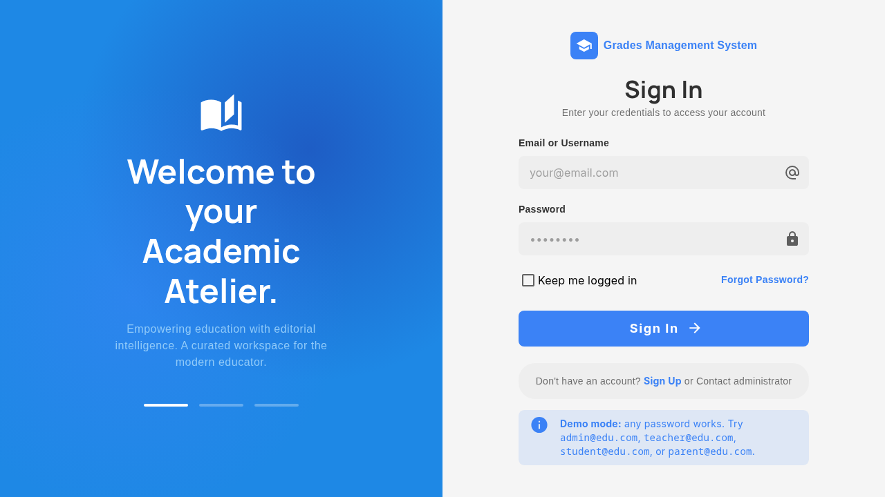

# 🎓 Grades Management System

AI-powered school grades platform. A Go backend syncs grades from Google Sheets into PostgreSQL and generates AI-based learning recommendations (Gemini); a Vue 3 frontend gives Admin/Teacher/Parent/Student each their own dashboard.

```
.
├── backend/   # Go API
└── frontend/  # Vue 3 SPA
```

## Stack

| Layer | Tech |
|---|---|
| Backend | Go, Gin, PostgreSQL (`pgx` + `sqlx`), JWT auth + refresh tokens, `robfig/cron`, Google Sheets API, Gemini AI |
| Frontend | Vue 3, Vuetify, Pinia, Vue Router, Vite, UnoCSS, TypeScript |

## Frontend pages

| Route | Page | Roles |
|---|---|---|
| `/login`, `/register` | Auth | everyone |
| `/dashboard` | Overview stats | all |
| `/dashboard/students` | Student detail & grades | admin, teacher, parent |
| `/dashboard/subjects` | Subjects | admin, teacher |
| `/dashboard/assignments` | Assignments | admin, teacher, student |
| `/dashboard/progress` | Progress & AI recommendation | admin, teacher, parent |
| `/dashboard/reports` | Reports | admin, teacher |
| `/dashboard/admin-data` | Raw CRUD over all tables | admin |
| `/dashboard/profile` | Profile edit | all |

Role-based routing is enforced client-side in `frontend/src/router/index.ts`.

### Dashboard page


- Stat cards: total students, active subjects, weekly progress %, average score (with trend deltas).
- Weekly progress trend chart (submissions vs. engagement).
- Top subjects ranked by score, with an AI-generated suggestion for the weakest one.
- Secondary stats: faculty active, system uptime, pending reviews.
- Upcoming assignments table (name, due date, status, submission count).



## Demo (no backend required)

The frontend works standalone: every API call falls back to mock data when the backend is unreachable (`frontend/src/api/*.ts`). Deployed as a static site (Vercel/Cloudflare Pages/GitHub Pages), it's a full click-through demo with no server.

Login with any password:
- `admin@edu.com`
- `teacher@edu.com`
- `student@edu.com`
- `parent@edu.com`

## Backend API

Base path `/api` (JWT-protected, role-gated per route) plus `/auth` (public):

| Group | Endpoints |
|---|---|
| `/auth` | `POST /register`, `POST /login`, `POST /refresh` |
| `/api/assign` | CRUD, admin/teacher write, all roles read |
| `/api/objective` | CRUD, admin/teacher write, all roles read |
| `/api/progress` | CRUD, admin/teacher write, all roles read (includes AI recommendation) |
| `/api/score` | CRUD, admin/teacher write, all roles read |
| `/api/student` | CRUD, admin only write, all roles read |
| `/api/subject` | CRUD, admin only write, all roles read |
| `/api/users` | CRUD, admin only |

A cron job runs hourly: syncs grades from Google Sheets into Postgres, then batches pending records through Gemini for AI recommendations.

## Running locally

**Backend**
```bash
cd backend
cp .env.example .env   # DB_URL, GEMINI_API_KEY, SHEETS_ID, GOOGLE_CREDENTIALS_PATH, JWT_SECRET
go mod tidy
go run main.go         # listens on :8080
```

**Frontend**
```bash
cd frontend
npm install
npm run dev             # http://localhost:5173, uses mock data if backend isn't running
npm run build            # production build -> dist/
```

## Deploying

- **Frontend**: static build, deploy to Vercel/Cloudflare Pages/GitHub Pages with **root directory = `frontend`**. GitHub Pages project pages need `base: '/<repo-name>/'` added to `vite.config.js`; Vercel/Cloudflare/Netlify don't.
- **Backend**: needs a host that keeps a persistent process running (the cron worker runs in-process) — e.g. Render, Railway, Fly.io, or a VPS. Not deployable to a static/serverless-only platform.

## Roles

- **Admin** — full access: users, schools, raw data tables.
- **Teacher** — input grades, manage classes, view AI recommendations for their class.
- **Parent** — monitor their child's grades and AI development suggestions.
- **Student** — view own grades and AI study tips.
